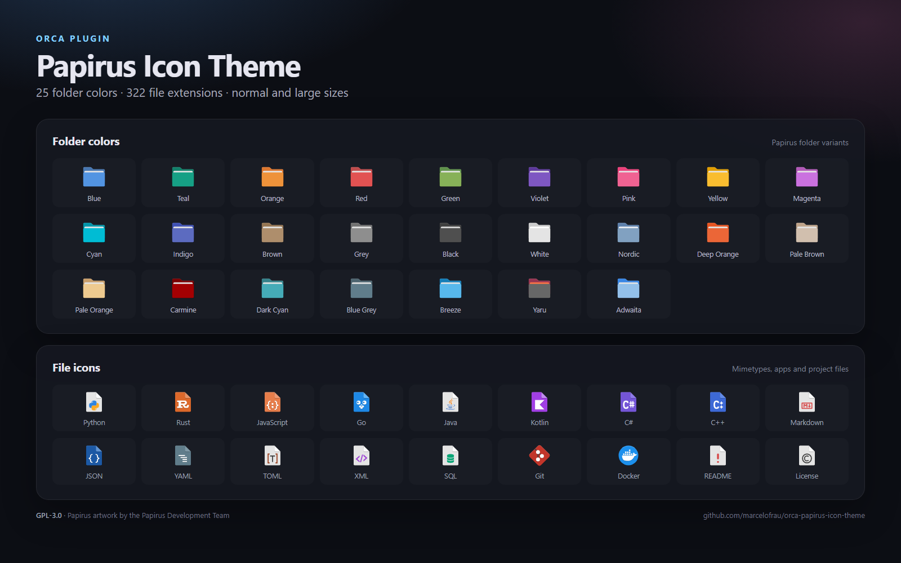
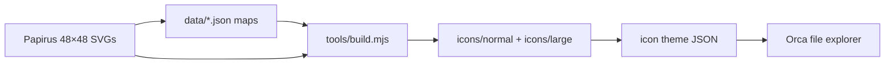

<div align="center">
  
  <h1>Papirus Icon Theme for Orca</h1>
  <p>Papirus file and folder icons for <a href="https://github.com/stablyai/orca">Orca</a>, with 25 folder colors and normal or large artwork.</p>

  <p>
    <a href="LICENSE"></a>
    <a href="https://github.com/stablyai/orca"></a>
    
    
    <a href="https://github.com/marcelofrau/orca-papirus-icon-theme/releases"></a>
    <a href="https://github.com/marcelofrau/orca-papirus-icon-theme/stargazers"></a>
  </p>
</div>

---

Orca ships a built-in icon set for its file explorer. This plugin replaces it with
[Papirus](https://github.com/PapirusDevelopmentTeam/papirus-icon-theme) artwork and
adds one icon theme per Papirus folder color. Pick a color under
**Settings → Appearance → Icon theme**.

## Highlights

- **25 folder colors** — Adwaita, Black, Blue, Blue Grey, Breeze, Brown, Carmine,
  Cyan, Dark Cyan, Deep Orange, Green, Grey, Indigo, Magenta, Nordic, Orange, Pale
  Brown, Pale Orange, Pink, Red, Teal, Violet, White, Yaru, Yellow.
- **Normal and Large artwork** — Large themes zoom the icon inside the same row.
  Available for Blue, Teal, Orange, Red, Green, Violet and Pink.
- **322 file extensions** — languages, config, documents, images, audio, video,
  archives, disks, executables, fonts, 3D/CAD.
- **Project-aware names** — `package.json`, `Cargo.toml`, `Dockerfile`,
  `.gitignore`, `README.md`, `LICENSE`, lock files and more.
- **Folder names** — `src`, `docs`, `assets`, `.github`, `node_modules`, `tests`,
  `build`, `dist` and other common folders get their own folder icon.
- Content-only plugin: no code runs and Orca asks for no approval.

## Install

Requires Orca 1.4.246 or newer.

```sh
orca plugin install marcelofrau/orca-papirus-icon-theme
```

From a local checkout:

```sh
git clone https://github.com/marcelofrau/orca-papirus-icon-theme
orca plugin install ./orca-papirus-icon-theme
```

To remove it: `orca plugin uninstall marcelofrau.papirus-icon-theme`.

## Choose a theme

Open **Settings → Appearance → Icon theme** and select one of the 32 entries:

| Theme | Sizes |
| --- | --- |
| Papirus Blue | Normal, Large |
| Papirus Teal | Normal, Large |
| Papirus Orange | Normal, Large |
| Papirus Red | Normal, Large |
| Papirus Green | Normal, Large |
| Papirus Violet | Normal, Large |
| Papirus Pink | Normal, Large |
| Every other color | Normal |

Large themes scale the artwork up to 1.2× using each icon's own content bounds, so
tall or edge-to-edge icons are not clipped. Orca caps a plugin at 32 icon themes,
which is why the default Large set covers seven colors. Edit `data/sizes.json` to
change the list.

## Coverage

| Kind | Count | Examples |
| --- | ---: | --- |
| Folder colors | 25 | blue, teal, orange, red, green, violet, pink |
| File extensions | 322 | `py`, `rs`, `ts`, `go`, `java`, `cs`, `json`, `yaml`, `md`, `pdf`, `png`, `mp4`, `zip`, `ttf` |
| File names | 30 | `package.json`, `Cargo.toml`, `Dockerfile`, `Makefile`, `.gitignore`, `LICENSE` |
| Folder names | 30 | `src`, `lib`, `docs`, `assets`, `tests`, `.github`, `node_modules`, `build` |
| Expanded folder names | 16 | `docs`, `downloads`, `pictures`, `videos`, `templates`, `remote` |

File type icons are shared by every color; only folder icons change color. Icons
come from Papirus 48×48 artwork, which is what Papirus itself serves for 16 px
lookups.

## How it works



Orca reads an icon theme artifact: three slots (`file`, `folder`, `folder-open`)
plus extension, file-name and folder-name maps. The build resolves Papirus
symlinks, rejects SVG features that Orca's sanitizer drops, applies the per-icon
bounds for Large themes, and enforces Orca's limits of 512 mappings and 512
distinct SVGs per theme.

## What it does not change

Orca's plugin API exposes **file and folder icons only**. Papirus has thousands of
application icons, but Orca's toolbar, sidebar, button and status icons are built
into the app and are not part of an icon theme. Replacing those would require
patching Orca's internal assets, which breaks on updates.

## Why file tree icons look small

Orca renders file tree icons in a fixed 12 px box (`size-3` in its UI). An icon
theme can only scale artwork **inside** that box; it cannot change the box itself.
The Large themes already fill as much of the 12 px box as the artwork allows
without clipping.

To make the file tree itself larger:

- Use Orca's UI zoom (`Ctrl` `+` / `Ctrl` `-`, or the `zoom.in` / `zoom.out`
  commands). This scales the whole interface, including the 12 px icon box.
- Ask Orca upstream for a file-tree icon size setting, or for plugin icons to use
  `size-3.5` / `size-4` instead of `size-3`.
- Patch Orca's renderer CSS locally. This is an app-level override: it breaks on
  every Orca update and is not something a plugin can ship.

## Development

The generated `icons/` folder and `orca-plugin.json` are committed, so installing
does not require a build.

```sh
git clone --depth 1 https://github.com/PapirusDevelopmentTeam/papirus-icon-theme .papirus
npm run build -- --source .papirus/Papirus
npm run validate
```

| File | Purpose |
| --- | --- |
| `data/extensions.json` | extension (without dot) to Papirus mimetype icon |
| `data/filenames.json` | exact lower-case file name to Papirus icon |
| `data/folders.json` | folder name to Papirus folder category, closed and expanded |
| `data/variants.json` | folder color to display label |
| `data/sizes.json` | size variants, artwork zoom and which colors get each size |
| `data/icon-bounds.json` | content bounds used to zoom each Large icon without clipping |
| `data/upstream.json` | Papirus release and commit used for the committed icons |

Papirus references use mimetype names (`text-x-python`) or app icons with an
`apps:` prefix (`apps:git`). After editing a map, rebuild and run
`npm run validate`. Committed icons were generated from Papirus `a1fd8b31`
(release `20250501`).

Load the checkout in place while developing; Orca reloads it on changes:

```sh
orca plugin dev load .
```

| Path | Contents |
| --- | --- |
| `icons/normal/` | normal-size file and folder SVGs |
| `icons/large/` | Large-size file and folder SVGs |
| `icons/themes/` | one Orca icon theme JSON per entry |
| `tools/build.mjs` | generator and validator |
| `docs/preview.png` | README preview, rendered from the real icons |

## Credits

Papirus artwork is GPL-3.0, © the
[Papirus Development Team](https://github.com/PapirusDevelopmentTeam/papirus-icon-theme).
The plugin itself is GPL-3.0. See [LICENSE](LICENSE).
